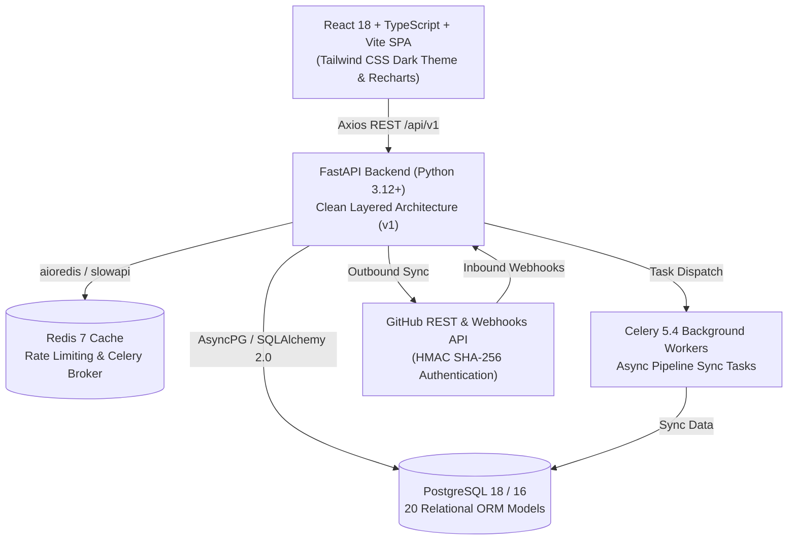

# 🚀 DevOpsPulse

**Enterprise-Ready Developer Productivity & CI/CD Observability Platform**

[](https://github.com/madhavjha86/DevOpsPulse/actions)
[](LICENSE)
[](https://python.org)
[](https://fastapi.tiangolo.com)
[](https://react.dev)
[](https://typescriptlang.org)
[](https://postgresql.org)
[](https://docker.com)

---

DevOpsPulse is an open-source Developer Productivity, CI/CD Observability, and Pipeline Monitoring Platform. Connect your GitHub repositories, track real-time commit velocity and pull requests, monitor GitHub Actions workflows, analyze build failure rates, calculate DORA metrics, diagnose pipeline failures using an AI-powered Copilot, and monitor Docker, Kubernetes, and Cloud infrastructure from a unified dashboard.

---

## 📸 Screenshots Gallery

### 📊 Real-Time Developer & CI/CD Dashboard
Unified visibility across repositories, commit velocities, workflow durations, and active pull requests.


### 🤖 AI Copilot & Root Cause Analysis
Intelligent root-cause diagnosis for broken builds and automated suggestions for resolving build and lint failures.


### 📈 DORA 4 Core Metrics
Track Deployment Frequency, Lead Time for Changes, Change Failure Rate, and Mean Time to Recovery (MTTR) with automated performance scoring.


### 🐳 Infrastructure & Container Monitoring
Live observability across Docker hosts, Kubernetes clusters, and multi-cloud accounts (AWS, Azure, GCP).


---

## 🌟 Feature Breakdown

### ✅ Implemented Features (v1.0 Production Release)
- **🔐 Enterprise Authentication & Access Control**: Stateless JWT access (30m) & refresh (7d) tokens, bcrypt password hashing, GitHub OAuth 2.0 single sign-on, and RBAC (`admin`, `user`, `viewer`).
- **🐙 GitHub Integration & Webhooks**: Connect GitHub accounts, import public/private repositories, sync commits, PRs, and workflow runs, with HMAC-SHA256 signature verification on inbound webhooks.
- **📊 Real-Time Analytics Dashboard**: Real-time KPI summary (Repositories, Commits, PRs, Issues, Builds, Success Rate), Recharts 30-day build success/failure area charts, workflow duration histograms, and commit velocity charts.
- **📈 DORA Metrics Engine**: Automatic calculation of Deployment Frequency, Lead Time for Changes, Change Failure Rate, and MTTR with realistic "Awaiting Deployments" empty states.
- **🤖 AI DevOps Copilot & Automated RCA**: Interactive troubleshooting assistant with persistent conversations and automated root cause analysis for pipeline errors.
- **🔍 AI Pull Request Reviewer & Security Scanner**: Automated PR diff analysis detecting secret leaks, performance bottlenecks, and code smell violations.
- **🐳 Infrastructure Monitoring**: Docker host container listing, Kubernetes cluster resource and pod tracking, and multi-cloud (AWS, Azure, GCP) health monitoring with graceful offline tolerance.
- **📡 OpenTelemetry Telemetry Ingestion**: Ingest and query distributed spans, service waterfalls, and structured logs.
- **🔔 Smart In-App Notifications**: Real-time pipeline failure alerts, completion notifications, and unread counters.

### 🗺️ Planned Roadmap Features (v1.1+)
- [ ] Multi-tenant Organization Workspaces with granular permissions.
- [ ] Slack & PagerDuty webhook alert dispatchers.
- [ ] GitLab, Bitbucket, and Azure DevOps repository connectors.
- [ ] Automated PR remediation auto-commit bots.
- [ ] Prometheus & Grafana native metric scrapers.

---

## 🏗️ Architecture & Technology Stack



| Layer | Technologies | Purpose |
|---|---|---|
| **Backend** | Python 3.12+, FastAPI, SQLAlchemy 2.0 (async), Pydantic v2 | High-concurrency async REST API |
| **Database** | PostgreSQL 18 / 16 + Alembic (7 migrations) | ACID relational persistence across 20 models |
| **Queue & Cache** | Redis 7 + Celery 5.4 | Background synchronization and task queues |
| **Frontend** | React 18, TypeScript, Vite, Tailwind CSS, Lucide Icons | Responsive dark-mode dashboard |
| **Data Viz** | Recharts | Interactive time-series and area charts |
| **E2E Testing** | Playwright (Chromium) | Headless end-to-end browser journey verification |
| **DevOps** | Docker, Docker Compose, GitHub Actions | Containerized orchestration and CI testing |

---

## 📁 Project Directory Structure

```
DevOpsPulse/
├── .github/
│   └── workflows/
│       └── ci.yml                         # GitHub Actions automated CI pipeline
├── backend/
│   ├── alembic/                           # Database schema migrations (001 - 007)
│   ├── app/
│   │   ├── api/v1/routes/                 # REST API endpoints (auth, repos, telemetry, etc.)
│   │   ├── core/                          # Security, config, exceptions, logging
│   │   ├── db/                            # SQLAlchemy async session & declarative base
│   │   ├── middleware/                    # Rate limiting & request logging
│   │   ├── models/                        # 20 ORM database models
│   │   ├── repositories/                  # Data access layer
│   │   ├── schemas/                       # Pydantic v2 request/response schemas
│   │   ├── services/                      # Domain business services
│   │   └── workers/                       # Celery async tasks
│   ├── scripts/                           # Release verification and utility scripts
│   ├── tests/                             # 58 pytest unit & integration test cases
│   ├── .env.example                       # Sanitized environment template (DEBUG=false)
│   ├── Dockerfile                         # Container image definition
│   ├── pytest.ini                         # Pytest runner configuration
│   └── requirements.txt                   # Pinned Python dependencies
├── frontend/
│   ├── e2e/                               # 11 Playwright end-to-end browser test suites
│   ├── public/                            # Static web assets
│   ├── src/
│   │   ├── components/                    # UI, layout, auth, and dashboard components
│   │   ├── context/                       # AuthContext state management
│   │   ├── pages/                         # Application views (Dashboard, DORA, etc.)
│   │   ├── services/                      # Axios API clients
│   │   └── types/                         # TypeScript definitions
│   ├── Dockerfile                         # Frontend container image definition
│   ├── eslint.config.js                   # ESLint configuration
│   ├── package.json                       # Dependencies and scripts
│   ├── playwright.config.ts               # Playwright configuration
│   └── run_e2e.py                         # Automated E2E test stack orchestrator
├── docs/
│   ├── api/                               # REST API specifications
│   ├── architecture/                      # Architecture reference documents
│   └── screenshots/                       # High-resolution application screenshots
├── .env.example                           # Root sanitized environment template
├── .gitignore                             # Hardened ignore rules (databases, secrets, caches)
├── docker-compose.yml                     # Multi-service container orchestration
├── CONTRIBUTING.md                        # Contribution guidelines
├── SECURITY.md                            # Vulnerability disclosure policy
├── LICENSE                                # MIT License
└── README.md
```

---

## ⚡ Quick Start

### Prerequisites
- **Git** (v2.30+)
- **Node.js** (v20+ or v18+) and **npm**
- **Python** (v3.12+ or v3.13+)
- **PostgreSQL** (v16+ or v18+) or **Docker Desktop**

---

### Option A: Docker Compose Setup

> [!NOTE]
> Docker Compose orchestration is verified via static configuration audit. Ensure the Docker daemon or Docker Desktop is active on your machine before starting.

1. **Clone the repository**:
   ```bash
   git clone https://github.com/madhavjha86/DevOpsPulse.git
   cd DevOpsPulse
   ```

2. **Configure environment**:
   ```bash
   cp .env.example .env
   ```

3. **Start services**:
   ```bash
   docker compose up --build
   ```

- **Frontend Dashboard:** [http://localhost:3000](http://localhost:3000)
- **Backend API:** [http://localhost:8000](http://localhost:8000)
- **Interactive Swagger Docs:** [http://localhost:8000/docs](http://localhost:8000/docs)

---

### Option B: Local Manual Setup (Without Docker)

#### 1. Backend Setup
```bash
cd backend

# Create and activate Python virtual environment
python -m venv .venv
source .venv/bin/activate  # On Windows: .venv\Scripts\activate

# Install dependencies
pip install -r requirements.txt

# Copy environment configuration
cp .env.example .env

# Run database migrations
alembic upgrade head

# (Optional) Seed demo users and repositories
python seed_data.py

# Start FastAPI backend
uvicorn app.main:app --reload --port 8000
```

#### 2. Frontend Setup
```bash
cd frontend

# Install Node.js dependencies
npm install

# Start Vite development server
npm run dev
```

---

## 🔌 Integration Modes & Credential Dependencies

DevOpsPulse operates with progressive enhancement across local and production setups:

| Integration | Out-of-the-Box Local Behavior | Connected Production Requirement |
|---|---|---|
| **User Authentication** | Fully functional (Bcrypt + JWT tokens) | Set strong `SECRET_KEY` (32+ random characters) |
| **GitHub OAuth 2.0** | Username/password authentication active | Register GitHub OAuth App; set `GITHUB_CLIENT_ID` & `GITHUB_CLIENT_SECRET` |
| **GitHub Repository Sync** | Seeded sample repositories (`react`, `flask`) | Provide GitHub Personal Access Token or OAuth token for live sync |
| **Cloud Monitoring** | Demo/mock accounts with realistic metrics | Supply AWS IAM keys, Azure Service Principal, or GCP Service Account JSON |
| **Docker & Kubernetes** | Graceful offline tolerance; demo hosts/clusters | Mount `/var/run/docker.sock` or supply `KUBECONFIG` path |
| **AI Copilot & PR Review** | Rule-based static analyzer & heuristic prediction | Optional LLM API integration |
| **Asynchronous Worker** | Synchronous fallback; memory rate-limiter | Running Redis instance (`REDIS_URL=redis://localhost:6379/0`) |

> [!WARNING]
> Default demo credentials (`admin@devopspulse.com` / `Password123!`) are strictly intended for local development and integration testing. Change administrator credentials immediately upon deploying to any public or staging environment.

---

## 🧪 Automated Testing

DevOpsPulse incorporates comprehensive test suites across both backend and frontend layers:

### Backend Pytest Suite
```bash
cd backend
pytest -v
```
Validates JWT auth, password hashing, HMAC webhooks, rate limiting, and all REST endpoints (**58/58 tests passing**).

### Frontend Code Quality & Type Check
```bash
cd frontend
npm run lint    # ESLint (0 errors, 0 warnings)
npm run build   # TypeScript tsc + Vite production build
```

### Frontend Playwright End-to-End Suite
```bash
# Automated stack runner (starts Uvicorn + Vite and executes Playwright tests):
python frontend/run_e2e.py

# Or directly using the Playwright CLI:
cd frontend
npx playwright test
```
Validates authentication flows, protected route navigation, dashboard KPI cards, and repository detail views in headless Chromium (**11/11 tests passing**).

---

## 📡 API Reference Overview

| HTTP Method | Route | Description | Auth Required |
|---|---|---|---|
| `POST` | `/api/v1/auth/register` | Register new user account | No |
| `POST` | `/api/v1/auth/login` | Exchange credentials for JWT access/refresh tokens | No |
| `GET` | `/api/v1/auth/github/authorize` | Get GitHub OAuth URL | No |
| `GET` | `/api/v1/repositories` | List tracked repositories (paginated) | Yes |
| `POST` | `/api/v1/repositories/import` | Import a repository by `owner/repo` | Yes |
| `POST` | `/api/v1/repositories/{id}/sync` | Trigger on-demand sync from GitHub | Yes |
| `GET` | `/api/v1/workflows` | List GitHub Actions workflow runs | Yes |
| `GET` | `/api/v1/analytics/dashboard` | Aggregate dashboard summary metrics | Yes |
| `GET` | `/api/v1/analytics/dora` | Compute DORA metrics (Deployment Frequency, Lead Time, CFR, MTTR) | Yes |
| `GET` | `/api/v1/analytics/build-trends` | 30-day build success vs. failure time-series | Yes |
| `POST` | `/api/v1/ai/copilot/chat` | Send prompt to AI Copilot assistant | Yes |
| `POST` | `/api/v1/ai/intelligence/reviews/generate` | Run automated PR code review & security scan | Yes |
| `POST` | `/api/v1/webhooks/github` | Receive GitHub events with HMAC verification | Signature Header |

Interactive Swagger documentation is available at `/docs`.

---

## 🤝 Contributing

Contributions are welcome! Please read [CONTRIBUTING.md](CONTRIBUTING.md) for details on code style, commit conventions, and pull request guidelines.

---

## 🔒 Security

For vulnerability disclosure, please refer to [SECURITY.md](SECURITY.md).

---

## 📄 License

This project is licensed under the MIT License — see the [LICENSE](LICENSE) file for details.
