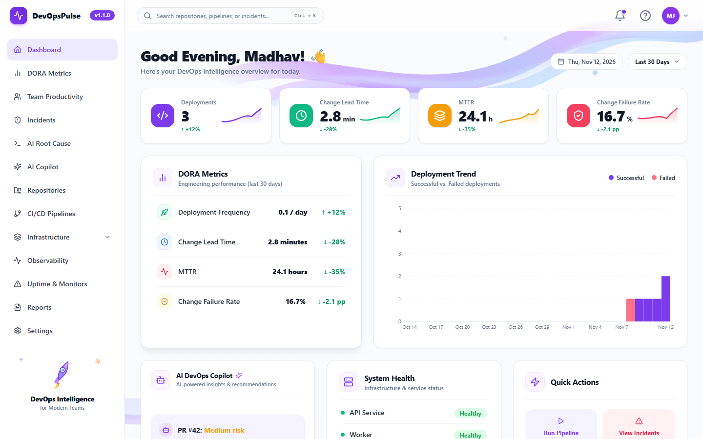
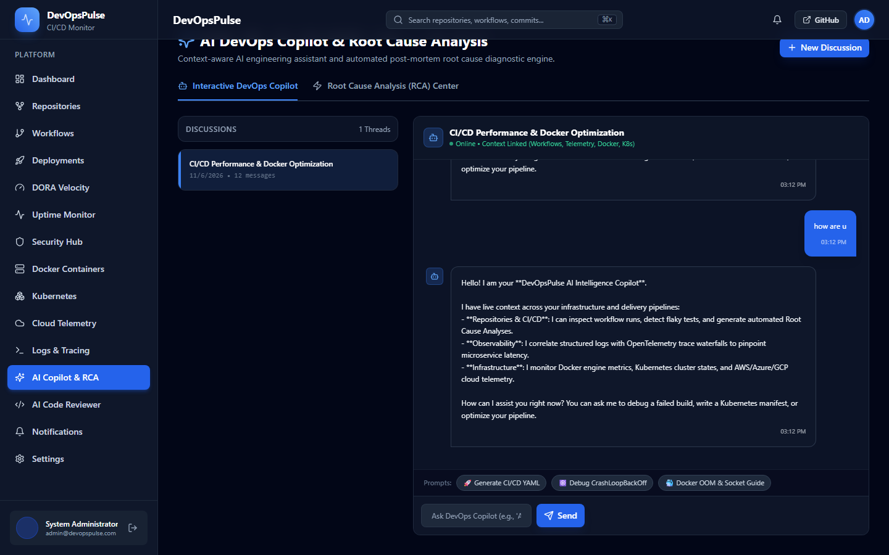
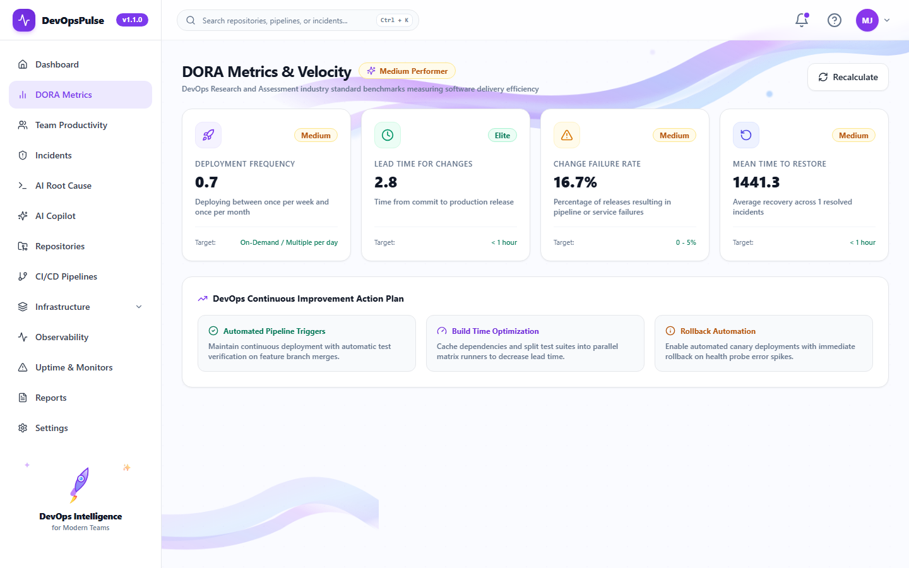
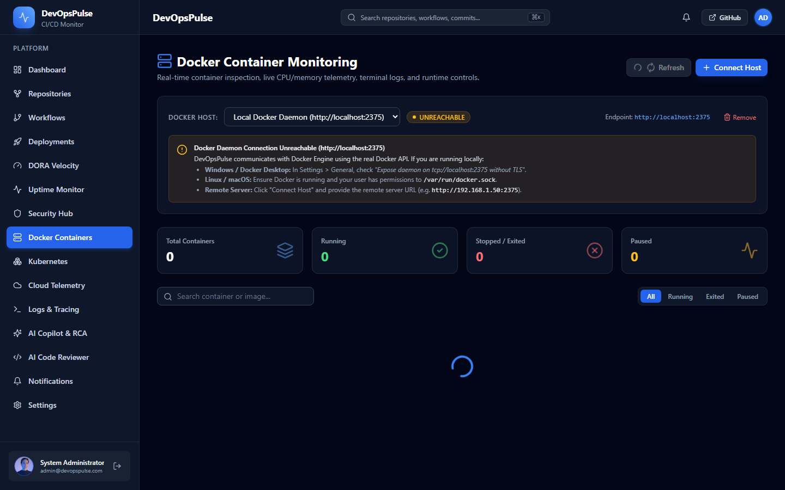

# 🚀 DevOpsPulse

**Enterprise-Grade Developer Productivity, Multi-Tenant SaaS & CI/CD Observability Platform**

[](https://github.com/madhavjha86/DevOpsPulse/actions)
[](LICENSE)
[](https://python.org)
[](https://fastapi.tiangolo.com)
[](https://react.dev)
[](https://typescriptlang.org)
[](https://postgresql.org)
[](https://docker.com)

---

DevOpsPulse is an open-source Developer Productivity, CI/CD Observability, and Pipeline Monitoring Platform. Connect your GitHub repositories, track real-time commit velocity and pull requests, monitor GitHub Actions workflows, analyze build failure rates, calculate DORA metrics, diagnose pipeline failures using an AI-powered Copilot, and monitor Docker, Kubernetes, and Cloud infrastructure from a unified, multi-tenant dashboard.

---

## 📸 Screenshots Gallery

### 📊 Real-Time Developer & CI/CD Dashboard
Unified visibility across repositories, commit velocities, workflow durations, and active pull requests.


### 🤖 AI Copilot & Root Cause Analysis
Intelligent root-cause diagnosis for broken builds and automated suggestions for resolving build and lint failures.


### 📈 DORA 4 Core Metrics
Track Deployment Frequency, Lead Time for Changes, Change Failure Rate, and Mean Time to Recovery (MTTR) with automated performance scoring.


### 🐳 Infrastructure & Container Monitoring
Live observability across Docker hosts, Kubernetes clusters, and multi-cloud accounts (AWS, Azure, GCP).


---

## 🌟 Core Features

- **🏢 Multi-Tenant SaaS Architecture**: Strict workspace boundary isolation supporting individual developer **Personal Workspaces** and enterprise **Company Workspaces** (`organizations` & `organization_members` partitioned data).
- **🛡️ 6 Enterprise RBAC Roles**: Granular permission enforcement for `SUPER_ADMIN`, `ORGANIZATION_ADMIN`, `DEVOPS_ENGINEER`, `DEVELOPER`, `SECURITY_ENGINEER`, and `VIEWER`. Privilege escalation is strictly blocked (only Super Admins can assign Super Admin).
- **✉️ Secure Single-Use Invitations & Onboarding**: Single-use URL-safe invitation tokens hashed with SHA-256 in PostgreSQL, 48-hour expiration, self-service password onboarding, and configurable SMTP email dispatch with `EMAIL_NOT_CONFIGURED` direct link sharing.
- **🔐 Enterprise Authentication & Access Control**: Stateless JWT access (30m) & refresh (7d) tokens, bcrypt password hashing (12 rounds), GitHub OAuth 2.0 single sign-on, and context-driven workspace switching.
- **🐙 GitHub Integration & Webhooks**: Connect GitHub accounts, import public/private repositories, sync commits, PRs, and workflow runs, with HMAC-SHA256 signature verification on inbound webhooks.
- **📊 Real-Time Analytics Dashboard**: Real-time KPI summary (Repositories, Commits, PRs, Issues, Builds, Success Rate), Recharts 30-day build success/failure area charts, workflow duration histograms, and commit velocity charts.
- **📈 DORA Metrics Engine**: Automatic calculation of Deployment Frequency, Lead Time for Changes, Change Failure Rate, and MTTR with realistic "Awaiting Deployments" empty states.
- **🤖 AI DevOps Copilot & Automated RCA**: Interactive troubleshooting assistant with persistent conversations and automated root cause analysis for pipeline errors.
- **🔍 AI Pull Request Reviewer & Security Scanner**: Automated PR diff analysis detecting secret leaks, performance bottlenecks, and code smell violations.
- **🐳 Infrastructure Monitoring**: Docker host container listing, Kubernetes cluster resource and pod tracking, and multi-cloud (AWS, Azure, GCP) health monitoring with graceful offline tolerance.
- **📡 OpenTelemetry Telemetry Ingestion**: Ingest and query distributed spans, service waterfalls, and structured logs.
- **🔔 Smart In-App Notifications**: Real-time pipeline failure alerts, completion notifications, and unread counters.

---

## 🏗️ Architecture & Technology Stack

```mermaid
graph TD
    Client["React 18 + TypeScript + Vite SPA<br/>(Tailwind CSS Dark Theme & Recharts)"]
    API["FastAPI Backend (Python 3.12+)<br/>Multi-Tenant Layered Architecture"]
    DB[("PostgreSQL 18 / 16<br/>31 Relational ORM Models")]
    Cache[("Redis 7 Cache<br/>Rate Limiting & Celery Broker")]
    Workers["Celery 5.4 Background Workers<br/>Async Pipeline Sync Tasks"]
    GH["GitHub REST & Webhooks API<br/>(HMAC SHA-256 Authentication)"]

    Client -->|Axios REST /api/v1 (X-Organization-Id)| API
    API -->|AsyncPG / SQLAlchemy 2.0| DB
    API -->|aioredis / slowapi| Cache
    API -->|Task Dispatch| Workers
    Workers -->|Sync Data| DB
    GH -->|Inbound Webhooks| API
    API -->|Outbound Sync| GH
```

| Layer | Technologies | Purpose |
|---|---|---|
| **Backend API** | Python 3.12+, FastAPI, SQLAlchemy 2.0 (async), Pydantic v2 | High-concurrency async REST API with tenant scoping |
| **Database** | PostgreSQL 18 / 16 + Alembic (9 migrations) | ACID relational persistence across 31 partitioned models |
| **Queue & Cache** | Redis 7 + Celery 5.4 | Background synchronization and task queues |
| **Frontend** | React 18, TypeScript, Vite, Tailwind CSS, Lucide Icons | Responsive dark-mode dashboard with tenant switching |
| **Data Viz** | Recharts | Interactive time-series and area charts |
| **DevOps & CI** | Docker, Docker Compose, GitHub Actions | Multi-container orchestration and automated CI testing |

---

## 🛡️ Multi-Tenant RBAC Permissions Matrix

DevOpsPulse partitions all data and actions across 6 roles:

| Role | Hierarchy / Description | Primary Authority Scope |
|---|---|---|
| **SUPER_ADMIN** | Platform Administrator with root-level privileges | All organizations, system users, global telemetry, and workspace management. |
| **ORGANIZATION_ADMIN** | Tenant Workspace Owner / Administrator | Full control within designated organization: invite members, assign roles, configure integrations. |
| **DEVOPS_ENGINEER** | Operations, SRE, and Infrastructure Lead | CI/CD pipelines, Docker hosts, Kubernetes clusters, telemetry, and cost optimization. |
| **DEVELOPER** | Software Engineer / Contributor | Repositories, branches, commits, pull requests, AI code intelligence, and incident bug reporting. |
| **SECURITY_ENGINEER** | Security & Compliance Specialist | Security posture scorecard, vulnerability CVE triage, secret leak detection, and security scans. |
| **VIEWER** | Stakeholder / Auditor (Read-Only) | Read-only access to all dashboards, analytics, reports, repositories, and active monitors. |

### Privilege Escalation & Boundary Rules
1. **Super Admin Guard:** Only users with `is_superuser=True` can assign the `SUPER_ADMIN` role. Attempts by Organization Admins return `403 Forbidden`.
2. **Tenant Partitioning:** All requests include the `X-Organization-Id` header. The backend validates user membership; cross-tenant access returns `403 Forbidden`.
3. **Invitation Cryptography:** Raw invitation tokens are 43-character URL-safe strings (`secrets.token_urlsafe(32)`). Only the SHA-256 hexadecimal hash is stored in PostgreSQL. Tokens expire in 48 hours and can only be used once.

---

## ⚡ Quick Start Installation Guide

> 📖 **Full Multi-Platform Guide:** For a detailed step-by-step installation guide across Windows, Linux, and macOS, refer to [PUBLIC_INSTALLATION_GUIDE.md](PUBLIC_INSTALLATION_GUIDE.md).

### Prerequisites
- **Python:** 3.12+ (or 3.13)
- **Node.js:** 20.x LTS (with npm)
- **PostgreSQL:** 16.x or 18.x
- **Redis:** 7.x
- **Docker & Docker Compose** *(Optional, for containerized run)*

---

### Option A: Docker Compose (Fastest)

```bash
# 1. Clone the repository
git clone https://github.com/madhavjha86/DevOpsPulse.git
cd DevOpsPulse

# 2. Configure environment files
cp .env.example .env
cp backend/.env.example backend/.env

# 3. Start all services
docker compose up --build
```
- **Frontend Dashboard:** [http://localhost:3000](http://localhost:3000)
- **Backend API Docs (Swagger):** [http://localhost:8000/docs](http://localhost:8000/docs)
- **Backend Health Check:** [http://localhost:8000/health](http://localhost:8000/health)

---

### Option B: Local Native Setup (Windows, Linux, macOS)

#### 1. Database & Cache Setup
- **PostgreSQL:** Start your PostgreSQL service and create a database:
  ```sql
  CREATE DATABASE devopspulse;
  ```
- **Redis:** Start Redis on default port `6379` (`redis-server` or via Docker: `docker run -d -p 6379:6379 redis:7-alpine`).

#### 2. Backend Setup (FastAPI)
```bash
cd backend

# Create and activate virtual environment
# On Linux/macOS:
python3 -m venv venv && source venv/bin/activate
# On Windows (PowerShell):
python -m venv venv; .\venv\Scripts\Activate.ps1

# Install pinned dependencies
pip install --upgrade pip
pip install -r requirements.txt

# Configure environment
cp .env.example .env
# Edit backend/.env with your PostgreSQL credentials

# Run database migrations to HEAD (all 31 tables)
alembic upgrade head

# (Optional) Seed development demo accounts
python scripts/seed_rbac_accounts.py
python seed_data.py

# Start the FastAPI server
uvicorn app.main:app --reload --host 0.0.0.0 --port 8000
```

#### 3. Frontend Setup (React & Vite)
```bash
# In a new terminal:
cd frontend

# Install dependencies
npm install

# Start Vite dev server
npm run dev
```
Open [http://localhost:3000](http://localhost:3000) in your browser.

---

## 🔌 Integration Configuration Reference

> 📖 **Credentials & Policies Reference:** For complete IAM policies, webhook configurations, and environment variables, refer to [REQUIRED_CREDENTIALS_AND_SETUP.md](REQUIRED_CREDENTIALS_AND_SETUP.md).

DevOpsPulse operates with progressive enhancement across local and production setups:

| Integration | Out-of-the-Box Local Behavior | Connected Production Requirement |
|---|---|---|
| **User Authentication** | Fully functional (Bcrypt + JWT tokens) | Set a strong `SECRET_KEY` (64 random hex characters) |
| **Organization Invitations** | Displays `EMAIL_NOT_CONFIGURED` & copyable direct link | Set `SMTP_HOST`, `SMTP_PORT`, `SMTP_USER`, `SMTP_PASSWORD` in `backend/.env` |
| **GitHub OAuth 2.0** | Local email/password login active | Register GitHub OAuth App; set `GITHUB_CLIENT_ID` & `GITHUB_CLIENT_SECRET` |
| **GitHub Webhooks** | Signature verification enforced | Set `WEBHOOK_SECRET` and configure webhook in GitHub repo settings |
| **Docker Engine** | Offline graceful tolerance card | Mount `/var/run/docker.sock` or set Host URL `http://localhost:2375` |
| **Kubernetes Monitoring** | Offline graceful empty state | Apply read-only ServiceAccount manifest; supply cluster token & API URL |
| **Cloud FinOps** | Demo analytics with unconfigured badge | Attach read-only IAM policy (e.g. AWS Cost Explorer `ce:GetCostAndUsage`) |
| **AI Copilot & RCA** | Rule-based static analyzer fallback | Set `GEMINI_API_KEY` (Google AI Studio) or `OPENAI_API_KEY` in `backend/.env` |

---

## 🧪 Automated Testing

DevOpsPulse incorporates comprehensive test suites across both backend and frontend layers:

### Backend Pytest Suite (78 / 78 Passing)
```bash
cd backend
python -m pytest tests/ -v
```
Validates JWT auth, password hashing, 6 RBAC roles, multi-tenant boundaries, token SHA-256 hashing, HMAC webhooks, rate limiting, and all REST endpoints.

### Frontend Quality & Type Check
```bash
cd frontend
npm run lint    # ESLint (0 errors, 0 warnings)
npm run build   # TypeScript tsc + Vite production build (0 errors)
```

### End-to-End Browser Testing (Playwright)
```bash
cd frontend
python run_e2e.py    # Automated stack runner + Playwright tests
# Or directly:
npx playwright test
```

---

## 📁 Project Directory Structure

```
DevOpsPulse/
├── .github/
│   └── workflows/
│       └── ci.yml                         # GitHub Actions automated CI pipeline
├── backend/
│   ├── alembic/                           # Database schema migrations (001 - 009)
│   ├── app/
│   │   ├── api/v1/routes/                 # REST API endpoints (auth, orgs, repos, telemetry, etc.)
│   │   ├── core/                          # Security, config, exceptions, logging
│   │   ├── db/                            # SQLAlchemy async session & declarative base
│   │   ├── middleware/                    # Rate limiting & request logging
│   │   ├── models/                        # 31 ORM database models
│   │   ├── repositories/                  # Data access layer
│   │   ├── schemas/                       # Pydantic v2 request/response schemas
│   │   ├── services/                      # Domain business services (email, audit, orgs, etc.)
│   │   └── workers/                       # Celery async tasks
│   ├── scripts/                           # Security audits, seed scripts, and verification
│   ├── tests/                             # 78 pytest unit & integration test cases
│   ├── .env.example                       # Sanitized environment template
│   ├── Dockerfile                         # Container image definition
│   ├── pytest.ini                         # Pytest runner configuration
│   └── requirements.txt                   # Pinned Python dependencies
├── frontend/
│   ├── e2e/                               # Playwright end-to-end browser test suites
│   ├── public/                            # Static web assets
│   ├── src/
│   │   ├── components/                    # UI, layout, auth, and dashboard components
│   │   ├── context/                       # AuthContext & OrganizationContext state management
│   │   ├── pages/                         # Application views (Dashboard, OrgSettings, AcceptInvite, etc.)
│   │   ├── services/                      # Axios API clients
│   │   └── types/                         # TypeScript definitions
│   ├── Dockerfile                         # Frontend container image definition
│   ├── eslint.config.js                   # ESLint configuration
│   ├── package.json                       # Dependencies and scripts
│   ├── playwright.config.ts               # Playwright configuration
│   └── run_e2e.py                         # Automated E2E test stack orchestrator
├── docs/                                  # API specs, architecture, and screenshots
├── .env.example                           # Root sanitized environment template
├── .gitignore                             # Hardened ignore rules (databases, secrets, caches)
├── docker-compose.yml                     # Multi-service container orchestration
├── CONTRIBUTING.md                        # Contribution guidelines
├── CODE_OF_CONDUCT.md                     # Code of conduct
├── SECURITY.md                            # Vulnerability disclosure policy
├── PUBLIC_INSTALLATION_GUIDE.md           # Public multi-platform installation guide
├── REQUIRED_CREDENTIALS_AND_SETUP.md      # Credentials & integrations setup reference
├── LICENSE                                # MIT License
└── README.md                              # Master project documentation
```

---

## 🔒 Security & Vulnerability Reporting

- **Zero Hardcoded Secrets:** Passwords, tokens, and keys are strictly managed via environment variables.
- **Token Security:** Single-use invitation tokens are hashed with SHA-256 before storage in PostgreSQL and expire after 48 hours.
- **Password Security:** User passwords are encrypted with bcrypt (12 rounds) and individual salts.
- **Vulnerability Disclosure:** Please review [SECURITY.md](SECURITY.md) to report security concerns responsibly.

---

## 🤝 Contributing

Contributions are welcome! Please read [CONTRIBUTING.md](CONTRIBUTING.md) for details on code style, commit conventions, and pull request workflows.

---

## 📄 License

This project is licensed under the MIT License — see the [LICENSE](LICENSE) file for details.
