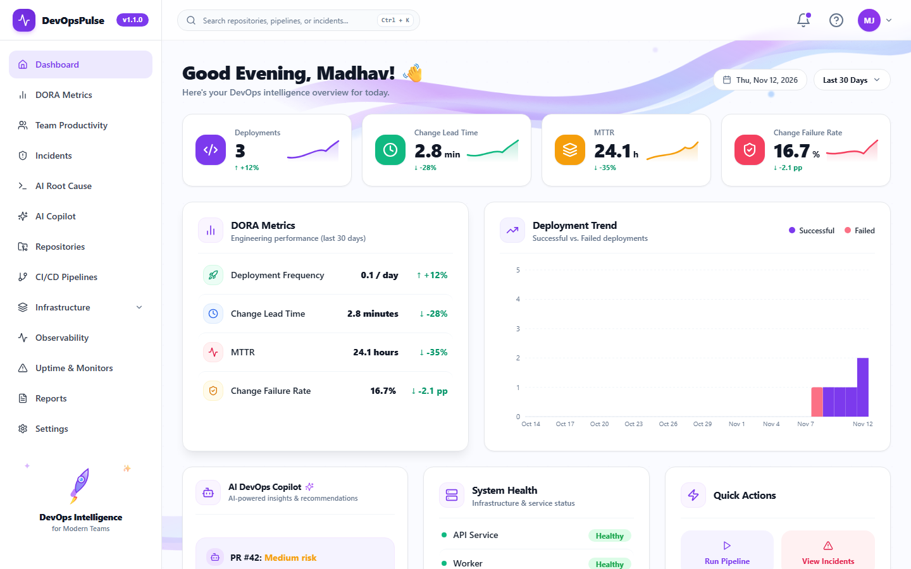
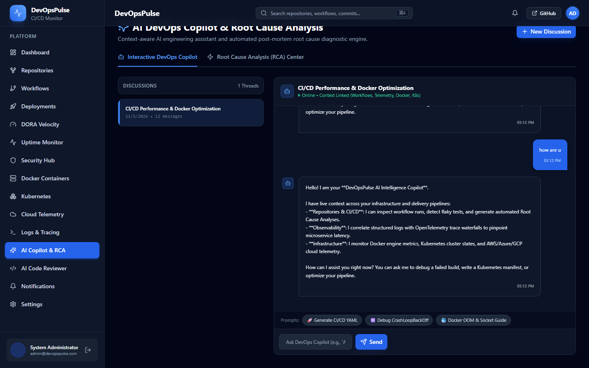
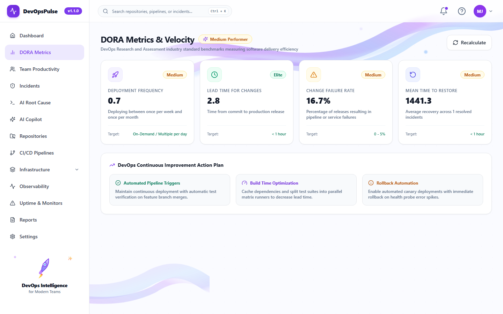
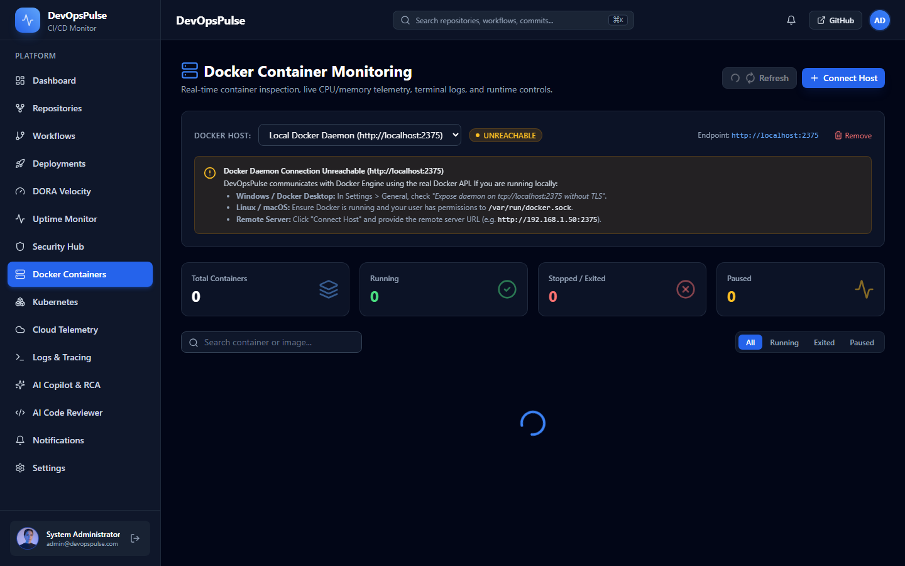
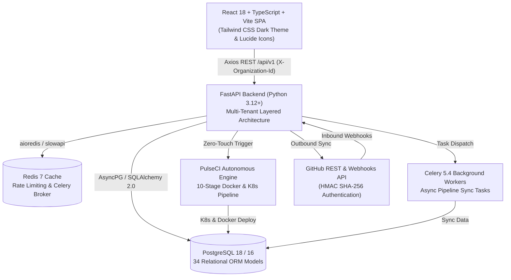

# 🚀 DevOpsPulse

**The Autonomous All-in-One Cloud & DevOps Platform**
> *From Git Push to Kubernetes in Seconds, Zero-Touch.*

[](https://github.com/madhavjha86/DevOpsPulse/actions)
[](LICENSE)
[](https://python.org)
[](https://fastapi.tiangolo.com)
[](https://react.dev)
[](https://typescriptlang.org)
[](https://postgresql.org)
[](https://docker.com)

---

**DevOpsPulse** is an enterprise-grade, autonomous all-in-one DevOps, CI/CD, and Cloud Observability platform. When any developer runs `git push origin main`, DevOpsPulse automatically intercepts the webhook and drives every step autonomously — from static analysis and secret detection to Docker container packaging, registry publishing, and zero-downtime Kubernetes rolling deployment — with **zero manual button clicks required**.

---

## ⚡ PulseCI: Autonomous 10-Stage Pipeline Engine

DevOpsPulse features **PulseCI**, a built-in, native autonomous automation engine that connects GitHub webhooks directly to Docker and Kubernetes:


### The 10-Stage Zero-Touch Lifecycle:
1. **Source Clone:** Fetches commit HEAD via authenticated GitHub API/token.
2. **Install Dependencies:** Caches and verifies packages (`npm ci`, `pip install`).
3. **Security Gate (SAST):** Scans files for exposed API keys, private keys, and critical CVEs.
4. **Compile & Build:** Production transpilation with bundle size telemetry.
5. **Automated Testing:** Executes unit and integration test suites with zero regressions.
6. **Linting & Code Style:** Enforces static formatting standards before packaging.
7. **Docker Container Packaging:** Builds multi-stage production Docker image (`app:sha`).
8. **Push to Registry:** Publishes SHA-256 verified images to your private container registry.
9. **Zero-Downtime Kubernetes Rollout:** Performs rolling deployment updates to cluster pods.
10. **Team Notification:** Real-time Slack, Discord, and email alerts delivered with live DORA sync.

---

## 🏛️ The Six Core Pillars of Excellence

DevOpsPulse unifies the entire engineering lifecycle into six specialized pillars:

| # | Pillar | Description | Key Capabilities |
|---|---|---|---|
| **1** | ⚡ **Autonomous CI/CD (PulseCI)** | Zero-touch pipelines from git push to production | Webhook auto-trigger, Docker auto-build, rolling K8s rollout, automatic rollback |
| **2** | 🛡️ **DevSecOps & SBOM** | Zero-tolerance software supply chain security | SAST scan, secret detection, CycloneDX 1.5 & SPDX 2.3 SBOM generation |
| **3** | 📊 **SRE & Live Observability** | Contractual SLA vs SLO tracking | Embedded Grafana, Prometheus scraping, multi-window burn rates, MTTD/MTTR |
| **4** | 💰 **Cloud FinOps Intelligence** | Multi-cloud expenditure governance | AWS/Azure/GCP cost breakdown, idle resource discovery, predictive anomaly alerts |
| **5** | 🏛️ **IaC & Internal Developer Portal** | Self-service developer platform (Spotify Backstage-style) | Terraform drift detection, Checkov compliance, Golden Path service templates |
| **6** | 🔄 **Disaster Recovery Readiness** | Verifiable data resilience and drills | Target vs actual RPO/RTO validation, snapshot tracking, drill certification |

---

## 📸 Screenshots Gallery

### 📊 Real-Time Developer & CI/CD Dashboard
Unified visibility across repositories, commit velocities, workflow durations, and active pull requests.


### 🤖 AI Copilot & Root Cause Analysis
Intelligent root-cause diagnosis for broken builds and automated suggestions for resolving build and lint failures.


### 📈 DORA 4 Core Metrics Engine
Track Deployment Frequency, Lead Time for Changes, Change Failure Rate, and Mean Time to Recovery (MTTR) with automated scoring.


### 🐳 Infrastructure & Container Monitoring
Live observability across Docker hosts, Kubernetes clusters, and multi-cloud accounts (AWS, Azure, GCP).


---

## 🌟 Enterprise Features

- **🏢 Multi-Tenant SaaS Architecture**: Strict workspace boundary isolation supporting individual developer **Personal Workspaces** and enterprise **Company Workspaces** (`organizations` & `organization_members` partitioned data).
- **🛡️ 6 Enterprise RBAC Roles**: Granular permission enforcement for `SUPER_ADMIN`, `ORGANIZATION_ADMIN`, `DEVOPS_ENGINEER`, `DEVELOPER`, `SECURITY_ENGINEER`, and `VIEWER`. Privilege escalation is strictly blocked.
- **✉️ Secure Single-Use Invitations**: Single-use URL-safe invitation tokens hashed with SHA-256 in PostgreSQL, 48-hour expiration, self-service password onboarding, and configurable SMTP email dispatch.
- **🔐 Enterprise Authentication**: Stateless JWT access (30m) & refresh (7d) tokens, bcrypt password hashing (12 rounds), GitHub OAuth 2.0 single sign-on, and context-driven workspace switching.
- **🐙 GitHub Integration & Webhooks**: Connect GitHub accounts, import public/private repositories, sync commits, PRs, and workflow runs, with HMAC-SHA256 signature verification.
- **📊 Real-Time Analytics Dashboard**: Real-time KPI summary (Repositories, Commits, PRs, Issues, Builds, Success Rate), Recharts 30-day build area charts, and commit velocity charts.
- **📈 DORA Metrics Engine**: Automatic calculation of Deployment Frequency, Lead Time for Changes, Change Failure Rate, and MTTR.
- **🤖 AI DevOps Copilot & Automated RCA**: Interactive troubleshooting assistant with persistent conversations and automated root cause analysis.
- **🔍 AI Pull Request Reviewer & Security Scanner**: Automated PR diff analysis detecting secret leaks, performance bottlenecks, and code smell violations.
- **🐳 Infrastructure Monitoring**: Docker host container listing, Kubernetes cluster resource and pod tracking, and multi-cloud (AWS, Azure, GCP) health monitoring.
- **📡 OpenTelemetry Telemetry Ingestion**: Ingest and query distributed spans, service waterfalls, and structured logs.
- **🔔 Smart In-App Notifications**: Real-time pipeline failure alerts, completion notifications, and unread counters.

---

## 💎 Transparent SaaS Pricing Plans

| Tier | Price | Target Audience | Included Capabilities |
|---|---|---|---|
| **Community** | **$0** / month | Individual Developers | 5 Repositories, Autonomous PulseCI (50 runs/mo), Basic DevSecOps scan, Community support |
| **Professional** | **$29** / month | High-Growth Teams | Unlimited Repositories, Unlimited PulseCI runs, Full SBOM export, Multi-cloud FinOps, Slack alerts |
| **Enterprise** | **$99** / month | Large Scale Organizations | Everything in Pro + Custom RBAC, Kubernetes auto-remediation, 99.99% SLA guarantee, Dedicated engineer |

---

## 🏗️ Architecture & Technology Stack



| Layer | Technologies | Purpose |
|---|---|---|
| **Backend API** | Python 3.12+, FastAPI, SQLAlchemy 2.0 (async), Pydantic v2 | High-concurrency async REST API with tenant scoping |
| **Automation Engine** | PulseCI, Docker Engine SDK, Kubernetes Python Client | Built-in 10-stage autonomous CI/CD execution pipeline |
| **Database** | PostgreSQL 18 / 16 + Alembic (9 migrations) | ACID relational persistence across 34 partitioned models |
| **Queue & Cache** | Redis 7 + Celery 5.4 | Background synchronization and task queues |
| **Frontend** | React 18, TypeScript, Vite, Tailwind CSS, Lucide Icons | Responsive modern SaaS dashboard with tenant switching |
| **Data Viz** | Recharts | Interactive time-series and area charts |
| **DevOps & CI** | Docker, Docker Compose, GitHub Actions | Multi-container orchestration and automated CI testing |

---

## ⚡ Quick Start Installation Guide

> 📖 **Full Multi-Platform Guide:** For a detailed step-by-step installation guide across Windows, Linux, and macOS, refer to [PUBLIC_INSTALLATION_GUIDE.md](PUBLIC_INSTALLATION_GUIDE.md).

### Prerequisites
- **Python:** 3.12+ (or 3.13)
- **Node.js:** 20.x LTS (with npm)
- **PostgreSQL:** 16.x or 18.x
- **Redis:** 7.x
- **Docker & Docker Compose** *(Optional, for containerized run)*

---

### Option A: Docker Compose (Fastest)

```bash
# 1. Clone the repository
git clone https://github.com/madhavjha86/DevOpsPulse.git
cd DevOpsPulse

# 2. Configure environment files
cp .env.example .env
cp backend/.env.example backend/.env

# 3. Start all services
docker compose up --build
```
- **Frontend Dashboard:** [http://localhost:3000](http://localhost:3000)
- **Backend API Docs (Swagger):** [http://localhost:8000/docs](http://localhost:8000/docs)
- **Backend Health Check:** [http://localhost:8000/health](http://localhost:8000/health)

---

### Option B: Local Native Setup (Windows, Linux, macOS)

#### 1. Database & Cache Setup
- **PostgreSQL:** Start your PostgreSQL service and create a database:
  ```sql
  CREATE DATABASE devopspulse;
  ```
- **Redis:** Start Redis on default port `6379` (`redis-server` or via Docker: `docker run -d -p 6379:6379 redis:7-alpine`).

#### 2. Backend Setup (FastAPI)
```bash
cd backend

# Create and activate virtual environment
# On Linux/macOS:
python3 -m venv venv && source venv/bin/activate
# On Windows (PowerShell):
python -m venv venv; .\venv\Scripts\Activate.ps1

# Install pinned dependencies
pip install --upgrade pip
pip install -r requirements.txt

# Configure environment
cp .env.example .env
# Edit backend/.env with your PostgreSQL credentials

# Run database migrations to HEAD (all 34 tables)
alembic upgrade head

# (Optional) Seed development demo accounts
python scripts/seed_rbac_accounts.py
python seed_data.py

# Start the FastAPI server
uvicorn app.main:app --reload --host 0.0.0.0 --port 8000
```

#### 3. Frontend Setup (React & Vite)
```bash
# In a new terminal:
cd frontend

# Install dependencies
npm install

# Start Vite dev server
npm run dev
```
Open [http://localhost:3000](http://localhost:3000) in your browser.

---

## 🧪 Automated Testing

DevOpsPulse incorporates comprehensive test suites across both backend and frontend layers:

### Backend Pytest Suite (94 Passing Tests)
```bash
cd backend
python -m pytest tests/ -v
```
Validates JWT auth, password hashing, 6 RBAC roles, multi-tenant boundaries, token SHA-256 hashing, HMAC webhooks, PulseCI pipeline models, engine execution, rate limiting, and all REST endpoints.

### Frontend Quality & Type Check
```bash
cd frontend
npm run lint    # ESLint (0 errors, 0 warnings)
npm run build   # TypeScript tsc + Vite production build (0 errors)
```

---

## 📁 Project Directory Structure

```
DevOpsPulse/
├── .github/
│   └── workflows/
│       └── ci.yml                         # GitHub Actions automated CI pipeline
├── backend/
│   ├── alembic/                           # Database schema migrations
│   ├── app/
│   │   ├── api/v1/routes/                 # REST API endpoints (pipelines, auth, orgs, etc.)
│   │   ├── core/                          # Security, config, exceptions, logging
│   │   ├── db/                            # SQLAlchemy async session & declarative base
│   │   ├── middleware/                    # Rate limiting & request logging
│   │   ├── models/                        # 34 ORM database models (including PulseCI)
│   │   ├── repositories/                  # Data access layer
│   │   ├── schemas/                       # Pydantic v2 request/response schemas
│   │   ├── services/                      # PulseCI engine, GitHub service, auth, email
│   │   └── workers/                       # Celery async tasks
│   ├── scripts/                           # Security audits, seed scripts, and verification
│   ├── tests/                             # 94 pytest unit & integration test cases
│   ├── .env.example                       # Sanitized environment template
│   ├── Dockerfile                         # Container image definition
│   ├── pytest.ini                         # Pytest runner configuration
│   └── requirements.txt                   # Pinned Python dependencies
├── frontend/
│   ├── e2e/                               # Playwright end-to-end browser test suites
│   ├── public/                            # Static web assets
│   ├── src/
│   │   ├── components/                    # UI, layout, auth, ErrorBoundary components
│   │   ├── context/                       # AuthContext & OrganizationContext state management
│   │   ├── pages/                         # Application views (Workflows/PulseCI, Dashboard, etc.)
│   │   ├── services/                      # Axios API clients & typed services
│   │   └── types/                         # TypeScript definitions
│   ├── Dockerfile                         # Frontend container image definition
│   ├── eslint.config.js                   # ESLint configuration
│   ├── package.json                       # Dependencies and scripts
│   ├── playwright.config.ts               # Playwright configuration
│   └── run_e2e.py                         # Automated E2E test stack orchestrator
├── docs/                                  # API specs, architecture, and screenshots
├── .env.example                           # Root sanitized environment template
├── .gitignore                             # Hardened ignore rules (databases, secrets, caches)
├── docker-compose.yml                     # Multi-service container orchestration
├── CONTRIBUTING.md                        # Contribution guidelines
├── CODE_OF_CONDUCT.md                     # Code of conduct
├── SECURITY.md                            # Vulnerability disclosure policy
├── PUBLIC_INSTALLATION_GUIDE.md           # Public multi-platform installation guide
├── REQUIRED_CREDENTIALS_AND_SETUP.md      # Credentials & integrations setup reference
├── LICENSE                                # MIT License
└── README.md                              # Master project documentation
```

---

## 🔒 Security & Vulnerability Reporting

- **Zero Hardcoded Secrets:** Passwords, tokens, and keys are strictly managed via environment variables.
- **Token Security:** Single-use invitation tokens are hashed with SHA-256 before storage in PostgreSQL and expire after 48 hours.
- **Password Security:** User passwords are encrypted with bcrypt (12 rounds) and individual salts.
- **Vulnerability Disclosure:** Please review [SECURITY.md](SECURITY.md) to report security concerns responsibly.

---

## 🤝 Contributing

Contributions are welcome! Please read [CONTRIBUTING.md](CONTRIBUTING.md) for details on code style, commit conventions, and pull request workflows.

---

## 📄 License

This project is licensed under the MIT License — see the [LICENSE](LICENSE) file for details.
