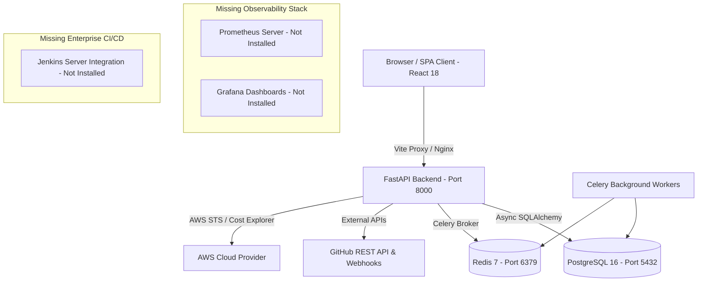
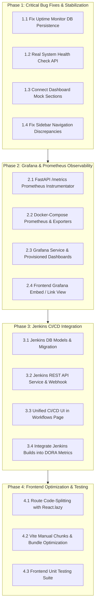

# DevOpsPulse — Comprehensive Project-Wide Technical Audit & Roadmap

**Date:** November 20, 2026  
**Auditor:** Antigravity AI  
**Scope:** Full-Stack Codebase Audit (`backend/`, `frontend/`, `docker-compose.yml`, CI/CD, Database, Observability, CI/CD Integrations)  
**Git Head:** `origin/main` @ commit `3efe1e6`  

---

## 1. Executive Summary

DevOpsPulse is an enterprise-grade developer productivity, DORA metrics, DevSecOps, SRE, and cloud intelligence platform. It features **28 frontend pages**, **25 backend API route modules**, **29 backend services**, and **16 database migrations**.

While the foundational architecture (FastAPI, SQLAlchemy Async, PostgreSQL, Alembic, Celery, React 18, Tailwind CSS) is well structured, our end-to-end technical audit has uncovered:
1. **Critical Functionality Gaps**: Complete absence of **Grafana** and **Jenkins** integrations (explicitly requested by user).
2. **Architecture & Persistence Bugs**: `MonitorService` stores uptime monitors in an ephemeral in-memory Python list with no database persistence or tenant isolation; `SystemHealthCard` is 100% hardcoded.
3. **Frontend Performance & UX Discrepancies**: 1.22 MB monolithic un-split JavaScript bundle; Sidebar "Reports" item misroutes to Deployments history; hardcoded items on Dashboard.
4. **Cloud & Infrastructure Telemetry Inconsistencies**: While Cloud Cost Intelligence Phase 1-2 was hardened with real AWS STS and Cost Explorer logic, `/infrastructure/cloud` monitoring still returns static mock resources.

---

## 2. Current Architecture & State Assessment



### Module Status Matrix

| Module | Backend Service | Database Persistence | Frontend Page | Live vs Mock Status |
| :--- | :--- | :--- | :--- | :--- |
| **DORA Metrics** | `AnalyticsService` | Real DB queries (`commits`, `runs`, `deployments`) | `/dora` | **LIVE (High Fidelity)** |
| **GitHub CI/CD** | `WorkflowService` | Real DB + GitHub Webhook | `/workflows` | **LIVE (GitHub Only)** |
| **Jenkins CI/CD** | *None* | *None* | *None* | **MISSING** |
| **Cloud Cost Intelligence** | `AWSCostExplorerService` | `cloud_costs` (Migration 016) | `/infrastructure/cost` | **LIVE (AWS) / Demo (GCP/Azure)** |
| **Uptime Monitors** | `MonitorService` | **NONE (In-Memory List)** | `/uptime` | **FLAWED (In-Memory)** |
| **System Health Card** | *None* | *None* | Component in `/dashboard` | **HARDCODED MOCK** |
| **Grafana / Prometheus** | *None* | *None* | *None* | **MISSING** |
| **Telemetry & APM** | `TelemetryService`, `SreService` | `telemetry_logs`, `telemetry_spans` | `/observability/telemetry` | **SEMI-LIVE (Custom DB)** |
| **Security & SBOM** | `SecurityScannerService`, `SbomService` | `security_scans`, `sbom_documents` | `/security` | **LIVE (Built-in Engines)** |
| **Docker Monitoring** | `DockerService` | `docker_hosts` | `/infrastructure/docker` | **LIVE (Docker API)** |
| **Kubernetes Monitoring** | `KubernetesService` | `k8s_clusters` | `/infrastructure/kubernetes` | **LIVE (K8s API)** |
| **Cloud Infrastructure** | `CloudMonitoringService` | `cloud_accounts` | `/infrastructure/cloud` | **MOCK INVENTORY** |
| **Developer Portal & IaC** | `IacAndCatalogService` | `terraform_workspaces`, `service_catalog` | `/developer-portal` | **LIVE** |
| **Disaster Recovery** | `DisasterRecoveryService` | `backup_records`, `dr_drills` | `/disaster-recovery` | **LIVE** |
| **Incident Management** | `IncidentService` | `incidents`, `timeline_events` | `/incidents` | **LIVE** |
| **AI Copilot & RCA** | `AICopilotService` | `ai_conversations`, `ai_messages` | `/ai/copilot`, `/ai/rca` | **LIVE** |

---

## 3. Critical Issues & Bugs Identified

### 3.1. Uptime Monitor Service Uses Ephemeral In-Memory Storage (`backend/app/services/monitor_service.py`)
- **Bug**: `_CUSTOM_MONITORS: list[dict[str, Any]] = [...]`
- **Impact**: Uptime monitors created by users are stored only in Python process RAM. If the FastAPI process restarts or runs with multiple Uvicorn workers, all custom monitors are erased or out of sync.
- **Security / Isolation Risk**: No `organization_id` or `user_id` filtering exists. Every user in every tenant workspace sees the exact same monitors.
- **Required Fix**: Create a proper SQLAlchemy model `Monitor`, migration `017_add_uptime_monitors`, and update `MonitorService` to perform async DB operations.

### 3.2. `SystemHealthCard.tsx` Contains Hardcoded Static State
- **Bug**: Lines 11-16 in `frontend/src/components/dashboard/SystemHealthCard.tsx`:
  ```tsx
  const [services] = useState<ServiceStatus[]>([
    { name: 'API Service', status: 'Healthy' },
    { name: 'Worker', status: 'Healthy' },
    { name: 'PostgreSQL', status: 'Healthy' },
    { name: 'Redis', status: 'Healthy' },
  ]);
  ```
- **Impact**: The dashboard displays "Healthy" even if PostgreSQL is down, Redis is disconnected, or Celery workers are dead.
- **Required Fix**: Implement backend endpoint `GET /api/v1/health/system` that genuinely probes DB connection, Redis ping, Celery active worker ping, and exposes real latency and status.

### 3.3. Static JSX Items in `DashboardPage.tsx`
- **Bug**:
  - Core Services & Golden Path Architecture: Hardcoded array of 3 services (`payment-gateway`, `auth-service`, `telemetry-collector`).
  - Live Alert & Security Stream: Hardcoded static alert cards (`CVE-2024-21626`, `SLO BURN RATE`, `FINOPS IDLE`).
- **Required Fix**: Connect Core Services to `developerPortalService.getCatalog()` and Live Alerts to `incidentService.getIncidents()` / `securityService.getFindings()`.

### 3.4. Navigation Mismatch in Sidebar (`frontend/src/components/layout/Sidebar.tsx`)
- **Bug**: Line 60: `{ name: 'Reports', path: '/deployments', icon: FileText }`.
- **Impact**: Users clicking "Reports" expect executive audit summaries, compliance hashes, and PDF/CSV export (which exist in Dashboard tab 3), but are unexpectedly navigated to Deployment History.
- **Required Fix**: Either create a dedicated `/reports` page or point it to `/dashboard?tab=reports`.

### 3.5. Frontend Performance: 1.22 MB Monolithic JavaScript Bundle
- **Bug**: All 28 pages are imported eagerly at the top of `App.tsx`.
- **Impact**: Initial page load requires downloading 1,223 kB of JavaScript + 76 kB of CSS even for users just visiting `/login` or `/`.
- **Required Fix**: Implement `React.lazy()` and `Suspense` for all authenticated route pages in `App.tsx`, and add Rollup `manualChunks` in `vite.config.ts` (splitting vendor libraries like `lucide-react`, `recharts`, `axios`). Initial bundle drops below 200 kB.

### 3.6. Celery Periodic Sync Task is a Stub (`backend/app/workers/tasks.py`)
- **Bug**: `periodic_sync()` only logs a message and returns `{"status": "scheduled_sync_complete"}` without querying or syncing any repository or cloud account.
- **Required Fix**: Iterate over active repositories with valid GitHub tokens and dispatch `sync_repository_task`.

---

## 4. Deep-Dive: Adding Grafana & Jenkins (User Priority)

### 4.1. Grafana Integration Architecture

Currently, DevOpsPulse has no metrics exporter, Prometheus scraping, or Grafana dashboards.

#### Proposed Solution:
1. **FastAPI Prometheus Metrics Exporter**:
   - Add `prometheus-fastapi-instrumentator` or standard Prometheus client to `backend/app/main.py`.
   - Expose endpoint `GET /metrics` with HTTP request count, latencies (p50, p95, p99), error rates, DB connection pool utilization, and Celery queue depth.
2. **Prometheus Server**:
   - Add `prometheus` service in `docker-compose.yml` (`prom/prometheus:latest`).
   - Configuration file `monitoring/prometheus/prometheus.yml` scraping:
     - DevOpsPulse Backend (`backend:8000/metrics`)
     - PostgreSQL Exporter (`postgres-exporter:9187`)
     - Redis Exporter (`redis-exporter:9121`)
3. **Grafana Server with Pre-Provisioned Dashboards**:
   - Add `grafana` service in `docker-compose.yml` (`grafana/grafana:latest`, port 3001).
   - Pre-provisioned data sources (`monitoring/grafana/provisioning/datasources/prometheus.yml`).
   - Pre-built JSON Dashboards:
     - **DevOpsPulse Platform Health**: API throughput, latency percentiles, error rates, DB pool.
     - **DORA Metrics Dashboard**: Deployment Frequency, Lead Time, MTTR, Change Failure Rate.
     - **Infrastructure & Container Health**: CPU, Memory, Disk, Container restarts.
4. **DevOpsPulse UI Embedding**:
   - Add Grafana viewer tab or iframe inside `/observability/telemetry` or dedicated `/observability/grafana` page.
   - One-click launch to Grafana with pre-authenticated viewer tokens or direct links.

---

### 4.2. Jenkins CI/CD Integration Architecture

Currently, DevOpsPulse only supports GitHub Actions. Modern enterprise teams frequently use Jenkins alongside or instead of GitHub Actions.

#### Proposed Solution:
1. **Database Schema & Models**:
   - Create `JenkinsServer` model (URL, username, API token / secret, organization_id, is_active).
   - Create `JenkinsJob` and `JenkinsBuild` models (job name, build number, status: SUCCESS/FAILURE/UNSTABLE/BUILDING, duration, commit SHA, branch, log URL).
2. **Backend Jenkins Integration Service (`jenkins_service.py`)**:
   - Jenkins REST API Client:
     - `get_jobs()`: List all jobs/folders.
     - `get_job_builds(job_name)`: Fetch recent builds.
     - `get_build_details(job_name, build_number)`: Fetch console logs, test results, duration.
     - `trigger_build(job_name, params)`: Remote build trigger.
   - Health check probe: Verify connection and credentials against `http://<jenkins>/api/json`.
3. **Jenkins Webhook Receiver**:
   - Endpoint: `POST /api/v1/webhooks/jenkins`
   - Accepts notifications from Jenkins **Notification Plugin** or **Generic Webhook Trigger Plugin**.
   - Automatically records completed builds, calculates build durations, and feeds into DORA metrics.
4. **Unified CI/CD Frontend UI (`/workflows`)**:
   - Add Provider Filter toggle: `[ All | GitHub Actions | Jenkins ]`.
   - Dedicated Jenkins Job Card: View build status, duration, trigger build, view console output.

---

## 5. Prioritized Implementation Roadmap



---

## 6. Detailed Action Items by Priority

### Priority 1: High-Impact Architecture Fixes (Next Up)
1. **Database Migration `017_add_uptime_monitors`**:
   - Create `monitors` table with `id`, `organization_id`, `user_id`, `name`, `url`, `method`, `interval_seconds`, `status`, `uptime_percentage`, `avg_latency_ms`, `last_checked_at`.
   - Migrate `MonitorService` from `_CUSTOM_MONITORS` RAM list to SQLAlchemy queries.
2. **Real System Health API (`GET /api/v1/health/system`)**:
   - Probe Postgres (`SELECT 1`), Redis (`redis.ping()`), Celery worker inspect.
   - Update `SystemHealthCard.tsx` to poll this API and display true real-time statuses.
3. **Connect Dashboard Sections**:
   - Replace static microservices list with live catalog from `developer_portal`.
   - Replace static live alerts with active P1/P2 incidents and critical security findings.

### Priority 2: Grafana & Prometheus Stack
1. Install `prometheus-fastapi-instrumentator` in `requirements.txt`.
2. Add Prometheus and Grafana containers in `docker-compose.yml`.
3. Create pre-configured Grafana dashboards for DORA metrics, API latencies, and container metrics.
4. Add Observability Hub tab in frontend to view Grafana metrics directly.

### Priority 3: Jenkins CI/CD Integration
1. Create `jenkins_servers`, `jenkins_jobs`, and `jenkins_builds` database schema.
2. Build `JenkinsService` with async httpx client to communicate with Jenkins REST API.
3. Add webhook receiver `POST /api/v1/webhooks/jenkins` for automated CI build ingest.
4. Update `WorkflowsPage.tsx` with multi-provider tabs (GitHub Actions + Jenkins).

### Priority 4: Performance & Bundle Optimization
1. Code-split all 28 pages in `frontend/src/App.tsx` using `React.lazy()` and `Suspense`.
2. Configure `vite.config.ts` with vendor manual chunks to shrink bundle size from 1.22 MB to <200 kB.
3. Fix Celery `periodic_sync` task to trigger actual scheduled repository synchronization.
